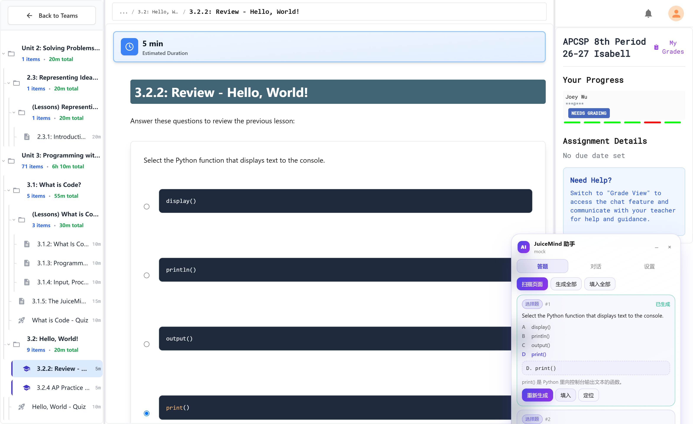
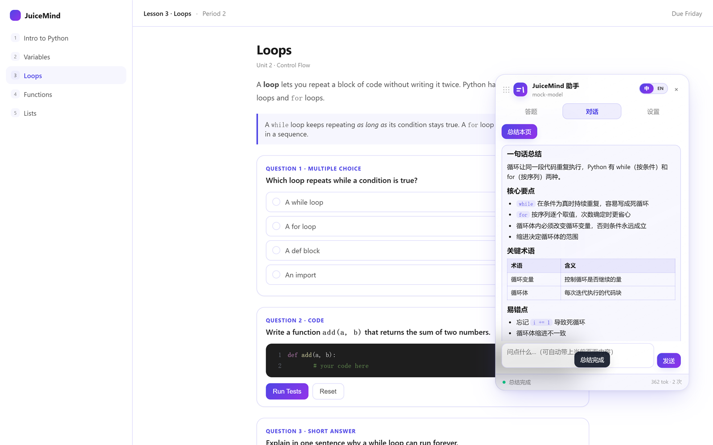
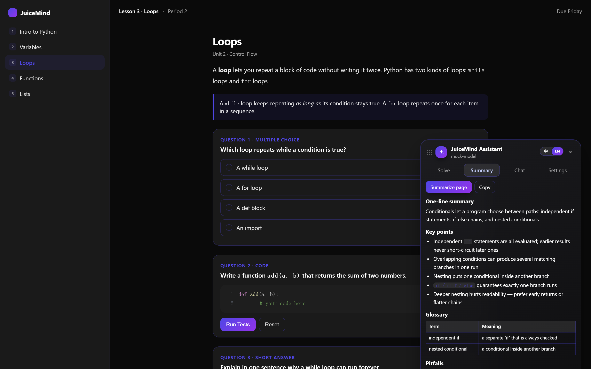
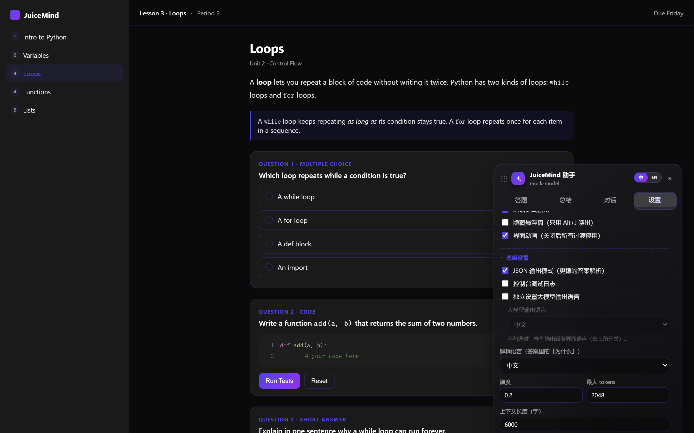
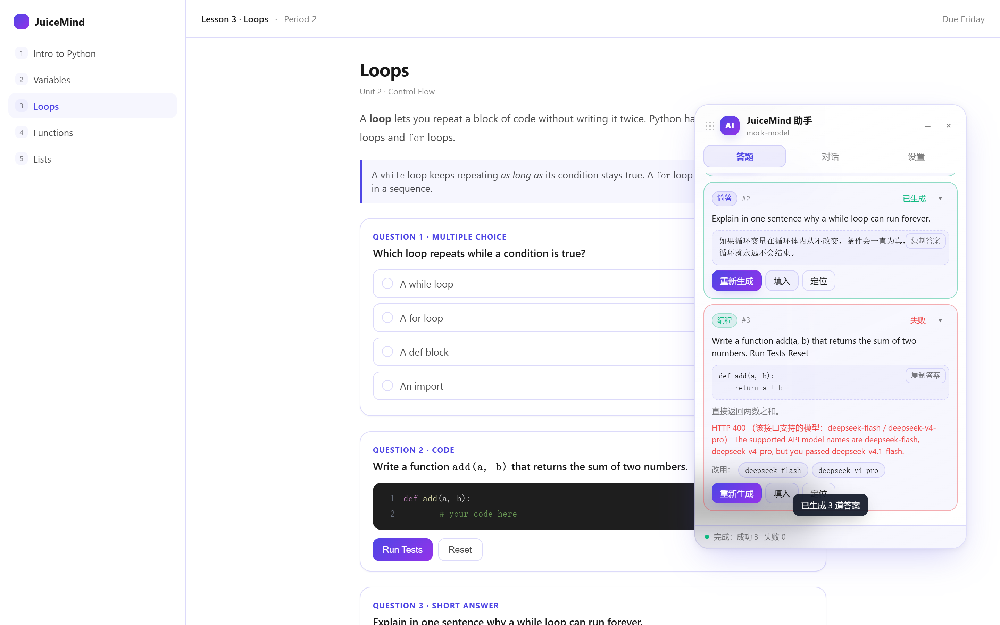

English | [中文](README.md)

# JuiceMind AI Assistant

A Tampermonkey userscript for [play.juicemind.com](https://play.juicemind.com). It reads the questions on the page, asks **your own** LLM API for answers, and fills them back in.

## Install (~1 min)

1. Install [Tampermonkey](https://www.tampermonkey.net/) in Chrome / Edge / Firefox.
2. Click the link below — Tampermonkey will open the install page, hit **Install**:

   **https://raw.githubusercontent.com/tev6/JuiceMind-Auto/main/juicemind-ai-assistant.user.js**

3. Open any lesson page. The panel shows up bottom-right; if not, press `Alt + J`.

## Configure (~30 s)

Open the **Settings** tab:

| Field | Example |
| --- | --- |
| API Base URL | `https://api.deepseek.com/v1` (or pick a provider preset) |
| API Key | your key |
| Model | any name, e.g. `deepseek-v4.1-flash` |

Save, then hit **Test connection**.

> Any OpenAI-compatible endpoint works: OpenAI, DeepSeek, Moonshot, OpenRouter, local Ollama, xAI, Gemini (OpenAI-compatible endpoint).

## Usage

| I want to… | Click |
| --- | --- |
| answer every question on the page | `Scan page` → `Generate all` → `Fill all` |
| answer just one | `Generate` → `Fill` on that card |
| skim a tutorial page | **Summary** tab -> Summarize page |
| ask about a tutorial page | switch to the **Chat** tab |

Shortcuts: `Alt + J` (`⌥ J` on macOS) show/hide · `Alt + Enter` generate all · `Alt + Shift + S` scan.

**One-click language switch**: the `中 / EN` toggle at the top right flips the whole plugin — UI text *and* the model's output language.

Each scanned card has a `▾` toggle for the full prompt, all options and the full answer. **Copy answer** on cards and **Copy code** on chat code blocks are one click.

The footer shows cumulative token usage for this session; while a request is running you can hit **Stop** on the right of the footer and keep whatever was already generated. Chat replies are rendered as Markdown (headings, lists, tables, code blocks) and stream in token by token.

Supported question types: multiple choice / multi-select / short answer / essay / fill-in-the-blank / Parsons, plus CodeMirror coding exercises and embedded IDE blocks.

**Advanced settings** live in a collapsed section at the bottom of Settings: temperature, max tokens, context length, extra prompt, explanation language, and *Set model output language separately* — off by default, so model output follows the top-right switch.

## FAQ

**No panel?** The script is disabled, or you are not on `*.juicemind.com`. Reload and press `Alt + J`.

**401 / 403** — wrong key, or Base URL missing `/v1`.

**`HTTP 400 ... supported API model names are ...`** — that endpoint does not accept your model name. The panel lists what it does support; click one to switch and retry:

**Nothing found** — wait for the page to finish loading. The coding-exercise editor takes 2–3 seconds; the script waits for it.

**Panel in the way?** Drag it by the header or footer; the position is remembered. Enable *Hide panel (Alt+J only)* in Settings and it stays out of sight until you press `Alt + J`.

## Development

- `src/part1..6.js` are the sources; they concatenate into `juicemind-ai-assistant.user.js`
- How the site is scraped and written to: [notes/site-analysis.md](notes/site-analysis.md)
- After editing `src/`, run `node scripts/build.mjs`; CI fails if the bundle and sources drift apart
- Installs auto-update: the header carries `@updateURL`, so Tampermonkey pulls a new build whenever the version changes
- Local tests: `npm i` then `npm test` (jsdom, 87 checks) and `npm run test:ui` (drag / hide / streaming, needs a local Chrome)
- Real-site checks and screenshots: put item IDs in `test/items.local.json` (template: `test/items.example.json`; that file is gitignored), then run `node test/real.js` / `node test/shots-real.js`

## Contributing

Tested against one APCSP course only — other JuiceMind courses are not verified, so the script may not fully work there. PRs and issues that add coverage for other courses, report bugs, or suggest improvements are welcome.

## Changelog

- **1.8.0** — animation pass: sliding tab pill, panel↔bubble open/close, card & bubble entrances, language knob; a single switch in Settings turns animations off. JSON output mode and console logs moved into Advanced; the auto-submit / auto-scan switches are temporarily hidden (features kept, moving into the Solve tab next). Scroll areas keep a 12px gap from their scrollbar.
- **1.7.1** — fixes: the language switch label/knob misalignment; English summaries still leaking Chinese (the whole prompt now switches language and demands English-only output); answers follow the output language while explanations follow the explanation language.
- **1.7.0** — one-click `中 / EN` switch in the header (UI text + model output language); the redundant collapse button is gone; Settings reorganized with an **Advanced** section (temperature / max tokens / context length / extra prompt / explanation language / separate model output language); the Summary tab now streams.
- **1.6.0** — a **Summary** tab that turns a tutorial page into quick-study notes (copyable); macOS keyboard support (⌥J via e.code, so Option-combining does not break it); the collapsed bubble is now draggable too; vector logo icon.
- **1.5.0** — auto-update for installed copies (`@updateURL`); automatic retry on 429/5xx/timeouts (exponential backoff, max 2, never after output started); token usage and a **Stop** button in the footer; `scripts/build.mjs` plus CI that keeps the bundle in sync with `src/`.
- **1.4.0** — streaming chat with a live caret; draggable panel (header *and* footer); **Hide panel** option (Alt+J only); English README.
- **1.3.0** — Markdown in chat; copy buttons for code and answers; expandable result cards; per-provider model lists (`deepseek-v4.1-flash`, `kimi-k3.1-pro`, `gpt-6.1-sol`, `gemini-3.8-flash`, …) plus xAI / Gemini presets.
- **1.2.0** — free-form model names; one-click switch when the server rejects a model.
- **1.1.0** — fixed coding pages not being found and 6 questions collapsing into 1.
- **1.0.0** — first release.

## Disclaimer

For learning and personal use. Follow your school's academic policy.
