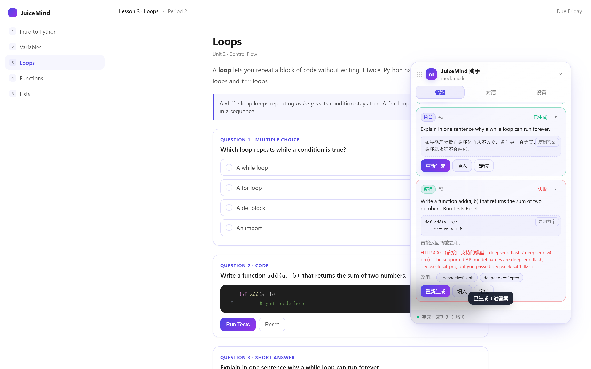

[English](README.en.md) | 中文

# JuiceMind AI 答题助手

给 [play.juicemind.com](https://play.juicemind.com) 用的 Tampermonkey 脚本：识别页面上的题目，调用**你自己的**大模型 API 生成答案，再填回页面。

## 安装（约 1 分钟）

1. 浏览器装 [Tampermonkey](https://www.tampermonkey.net/)（Chrome / Edge / Firefox 都行）。
2. 点这个链接安装脚本，Tampermonkey 弹出安装页后点「安装」：

   **https://raw.githubusercontent.com/tev6/JuiceMind-Auto/main/juicemind-ai-assistant.user.js**

3. 打开任意课程页，右下角会出现面板。没看到就按 `Alt + J`。

## 配置（约 30 秒）

点面板里的「设置」：

| 填什么 | 例如 |
| --- | --- |
| API Base URL | `https://api.deepseek.com/v1`（也可先选「服务商预设」自动填） |
| API Key | 你的 key |
| 模型 | 任意名字，例如 `deepseek-flash` |

点「保存」→「测试连接」，看到成功就能用了。

> 只要是 OpenAI 兼容接口都支持：OpenAI / DeepSeek / Moonshot / OpenRouter / 本地 Ollama。

## 使用

| 想做什么 | 怎么点 |
| --- | --- |
| 一页有好几道题 | `扫描页面` → `生成全部` → `填入全部` |
| 只做其中一题 | 该题卡片上点 `生成` → `填入` |
| 纯教程页 | 切到「对话」直接问 |

快捷键：`Alt + J` 收起/展开 · `Alt + Enter` 生成全部 · `Alt + Shift + S` 扫描。

扫描结果每张卡片右上角有 `▾`，点开看完整题干、全部选项和完整答案；卡片的「复制答案」和对话里代码块的「复制代码」都是一键复制。对话内容按 Markdown 渲染（标题 / 列表 / 表格 / 代码块）。

页脚会显示本会话累计的 token 用量；请求进行中可点页脚右侧的「停止」中断，已生成的内容会保留。

支持的题型：选择题 / 多选 / 简答 / 论述 / 填空 / 排序，以及 CodeMirror 编程练习和内嵌 IDE。

## 常见问题

**面板没出现** — 脚本没启用，或不在 `*.juicemind.com` 下。刷新后按 `Alt + J`。

**401 / 403** — Key 填错，或 Base URL 少了 `/v1`。

**`HTTP 400 ... supported API model names are ...`** — 你填的模型名这个接口不认。面板会列出它支持的名字，点一下就切过去重试：

**扫不到题** — 等页面加载完再扫；编程练习页的编辑器要 2~3 秒才出来，脚本会自己等几秒。

## 想改脚本

- `src/part1..6.js` 是源码分片，合并后就是 `juicemind-ai-assistant.user.js`
- 站点怎么选元素、怎么写进编辑器：见 [notes/site-analysis.md](notes/site-analysis.md)
- 改完 `src/` 后运行 `node scripts/build.mjs` 重新生成 bundle；CI 会校验两者是否一致
- 学生端会自动升级：脚本头带 `@updateURL`，Tampermonkey 每次检查到版本号变化就拉新版

## 贡献

本脚本由作者基于 APCSP 课程进行测试，暂未验证 JuiceMind 其他课程的适配情况。因此，作者无法保证该脚本在其他课程中也能完整运行。

欢迎通过 PR 或 Issue 补充其他课程的适配、报告问题，或提出改进建议。

## 更新记录

- **1.5.0** — 学生端自动更新（`@updateURL`）；请求失败自动重试（429/5xx/超时，指数退避，最多 2 次，已开始输出则不重试）；页脚新增 token 用量与「停止」按钮；新增 `scripts/build.mjs` 与 CI 校验 bundle 与 src 一致。
- **1.4.0** — 对话流式输出（带光标、可中断阅读）；悬浮窗可拖动（拖头部或底部，位置记住）；设置里新增「隐藏悬浮窗」（勾选后默认不显示，只用 `Alt+J` 唤出）；新增英文 README。
- **1.3.0** — 对话支持 Markdown 渲染；对话代码块与答案卡片都能一键复制；扫描结果可逐题展开（含「展开全部」）；模型下拉按服务商分类，补到 `deepseek-v4.1-flash`、`kimi-k3.1-pro`、`gpt-6.1-sol`、`gemini-3.8-flash` 等当前型号，并新增 xAI / Gemini 预设。
- **1.2.0** — 模型名自由填写；服务端拒绝模型名时给「改用 X」一键切换。
- **1.1.0** — 修复编程练习页扫不到题、一页 6 题只认成 1 题。
- **1.0.0** — 初版。

## 免责

仅供学习交流，请遵守所在学校的学术规范。
