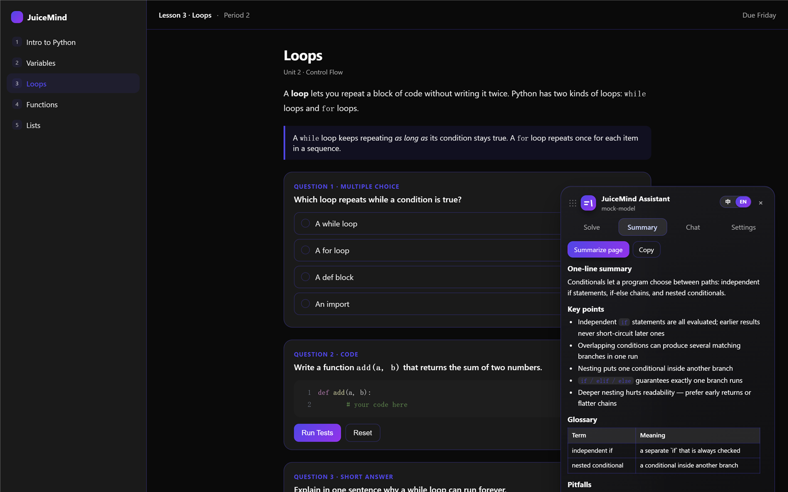

[中文](README.zh-CN.md) | English

  

# JuiceMind AI Answering Assistant

A Tampermonkey script for [play.juicemind.com](https://play.juicemind.com): it finds the questions on the page, calls a large language model API to generate answers, then fills them back in and submits everything automatically.

## Contents

- [Features](#features)
- [Install](#install)
- [Updating](#updating)
- [Configure](#configure)
- [Usage](#usage)
- [FAQ](#faq)
- [Development](#development)
- [Contributing](#contributing)
- [Changelog](#changelog)
- [License and Disclaimer](#license-and-disclaimer)

## Features

| Feature | What it does |
| --- | --- |
| **Complete the whole page** | detect → generate → fill in → submit, the same flow for every question |
| **Batch answers** | one request answers the whole page — 70% less input token on a 5-question page |
| **Token savings** | context trimmed per question, parsing off by default, max tokens follow the question type |
| **Human-like typing** | code questions are typed into the editor character by character, with a random pace and pauses — not one big replacement |
| **Quick-study notes** | a tutorial page condenses into notes: one-line summary, key points, glossary, pitfalls, self-check — and the notes land right in the chat, so you can keep asking about them |
| **Chat** | Markdown rendering, streaming replies, one-click copy of code blocks |
| **Chinese / English switch** | one toggle in the title bar switches the UI text and the model output language together |
| **Question types** | multiple choice / multi-select / short answer / essay / fill-in-blank, plus CodeMirror coding exercises and the embedded IDE |
| **Floating panel** | drag it around, collapse it into a round button, and watch the session token usage in the footer |

## Install

### Option 1 — one click

1. Install [Tampermonkey](https://www.tampermonkey.net/) in your browser (Chrome / Edge / Firefox).
2. Click the link below. Tampermonkey opens an install page — press "Install":

   **https://raw.githubusercontent.com/tev6/JuiceMind-Auto/main/juicemind-ai-assistant.user.js**

3. Open any JuiceMind lesson page. The panel shows up on the right side. If you don't see it, press `Alt + J`.

### Option 2 — paste it in yourself

If the one-click install doesn't work, or you'd rather look at the code before running it:

1. Open the script source in your browser:

   **https://raw.githubusercontent.com/tev6/JuiceMind-Auto/main/juicemind-ai-assistant.user.js**

2. Select all and copy — including the `// ==UserScript==` header at the top.
3. In Tampermonkey: toolbar icon → **Create a new script**.
4. Delete the template, paste, then save (Ctrl+S / Cmd+S).
5. Open any JuiceMind lesson page.

> A script you paste in still updates itself — the header carries `@updateURL`, so Tampermonkey pulls the new version on its own. To pull it by hand, see [Updating](#updating).

> The script only runs on the app domains `play.juicemind.com` and `classes.juicemind.com`. The marketing site `juicemind.com` has nothing but an intro page, so no panel is injected there.

## Updating

The script pulls new versions on its own, but Tampermonkey only checks about once a day and it still asks before swapping the new version in — so a release can sit unnoticed for a while. To update by hand:

1. Click the **Tampermonkey icon** in the browser toolbar.
2. Expand **JuiceMind AI Answering Assistant** in the list that drops down.
3. Click **Edit** — this opens the script's own page in a new tab.
4. Switch to the **Settings** tab.
5. Scroll down to **Updates** and click **Check for userscripts updates**.

Tampermonkey compares the version number with the one on GitHub. If there is something newer, it asks you to confirm — click **Yes**, then reload the JuiceMind tab to run the new version.

> The Tampermonkey dashboard (the page listing all your scripts) has a **Check for updates** button as well; it does the same thing for every script at once.

## Configure

Open "Settings" in the panel:

| Field | Example |
| --- | --- |
| API Base URL | `https://api.deepseek.com/v1` — or pick a "Provider preset" and it fills itself |
| API Key | `sk-...` (your own key) |
| Model | `deepseek-flash` |

Click **Save**, then **Test connection**. You're set.

> Any OpenAI-compatible API works: OpenAI / DeepSeek / Moonshot / OpenRouter / xAI / Gemini / local Ollama.

## Usage

| Scenario | How |
| --- | --- |
| **Complete the whole page** | Click **"Complete this page"** — detect → generate → fill in → submit, question by question |
| Solve many questions | `Scan page` → `Generate all` → `Fill all`. The three buttons show up one after another, so you only ever see the step you can take next; `Scan page` stays there so you can rescan |
| Solve one question | `Scan page` → on that card click `Generate` → `Fill` |
| Tutorial-only page | Open **Chat** and click **Summarize page** for quick-study notes, then keep asking follow-up questions in the same box |

Every question's outcome is reported back, so you always know whether the site accepted the answer.

Shortcuts: `Alt + J` (`⌥ J` on Mac) collapse / expand the panel · `Alt + Enter` generate all · `Alt + Shift + S` scan the page.

## FAQ

**Tampermonkey asks to allow a cross-origin resource** — click `Always allow domain` for that one API domain, or `Always allow` to stop seeing it. The script declares its cross-origin permission, so this only shows up on an old copy of the script or a strict Tampermonkey setting. See "Configure".

**The script didn't update itself** — Tampermonkey checks `@updateURL` about once a day, and it asks before applying an update, so a new version can sit unnoticed for a while. To pull it right now, follow the steps in [Updating](#updating) — toolbar icon → expand the script → **Edit** → **Settings** → **Updates** → **Check for userscripts updates**. The Tampermonkey dashboard has a **Check for updates** button that does the same thing for all your scripts at once.

**The panel never appears** — the script isn't enabled, or you're not on `play.juicemind.com` / `classes.juicemind.com`. Refresh and press `Alt + J`.

**401 / 403** — the key or the Base URL is wrong.

**`HTTP 400 ... supported API model names are ...`** — the model name you typed isn't one this API knows.

**Nothing gets scanned** — wait for the page to finish loading, then scan.

**What do the card badges mean?**

| Badge | Meaning |
| --- | --- |
| `submitted` | it went through, and the site accepted the answer (or is waiting for the teacher) |
| `submitted, incorrect` | it went through, but the site marked the answer wrong |
| `submit failed` | it did not go through (no button found, the button was still disabled, an API error) — the card spells out the reason |

**Answers can't be changed after submission** — that's how the site works. `submitted, incorrect` means it went through but the answer was wrong; all you can do is know the result. The AI you call can be wrong too, which is exactly why every question's outcome is reported back.

**What does "Complete this page" actually do?** For every question: fill in the answer, click submit, wait for the result, close the popup. Questions you already submitted are left alone — they are neither filled in again nor submitted again. Generation is still a single request (for the questions that are still open); only filling in and submitting happen question by question.

**Where are the advanced settings?** At the bottom of the settings page, in a collapsed section — temperature, two token budgets, context length, extra prompt, explanation language, and "Set model output language separately" (unchecked by default, so the model output follows the language switch in the top right).

**What are the two token settings?** *Max tokens (answers)* caps the output when the script generates answers (2048 by default); *Max tokens (page summary)* caps the page summary and the chat replies (4096 by default). Keeping them apart means a long summary no longer eats into the budget your answers get.

**How do I expand a collapsed scan, watch token usage, or move the panel?** Click the area above a collapsed scan to expand it and see the full question, every option, and the complete answer. The footer shows this session's token usage, with a "Stop" button while a request is running — whatever was already generated stays. Drag the panel by its title bar or bottom edge; collapsed, it becomes a round button you can also drag.

## Development

- `src/part1..6.js` are the source shards; merged together they become `juicemind-ai-assistant.user.js`
- How the script picks elements and how it writes into the editor: see [notes/site-analysis.md](notes/site-analysis.md)
- After editing `src/`, run `node scripts/build.mjs` to rebuild the bundle; CI checks that the two match
- Release loop: `node scripts/build.mjs --bump patch` bumps `@version`, `VERSION` and `package.json` together and rebuilds. CI fails the push if the bundle changed without a version bump — Tampermonkey only looks at the version number, so an unbumped release never reaches users
- Students update automatically: the script header carries `@updateURL`, and Tampermonkey pulls the new version whenever the version number changes
- Local tests: `npm i` → `npm test` (204 jsdom cases), `npm run test:ui` (drag / hide / streaming / one-click flow — needs a local Chrome)
- README images: `npm run shots` renders them from a local mock page, so they carry no personal data
- Icon: the design lives in `assets/icon/` — edit the SVG there, keep the coordinates even, then `node assets/icon/render.cjs` regenerates the PNGs
- Real-page acceptance and screenshots: put the item IDs into `test/items.local.json` (template: `test/items.example.json`; that file is not committed), then run `node test/real.js` / `node test/shots-real.js`

## Contributing

The author tested this script on the APCSP course inside JuiceMind, and has not verified it against other JuiceMind courses. So the author cannot promise it runs the same way on every course.

Pull requests and issues are welcome — to add support for other courses, report a problem, or suggest an improvement.

## Changelog

The full history lives in [CHANGELOG.en.md](CHANGELOG.en.md).

- **1.14.1** — **fixes "Complete this page" stopping after the first question**: the questions after it had **not** been submitted at all, but were reported as *already submitted — skipped*. The check for "has this been submitted?" looked too wide (it picked up other questions' status words) and read "the button is disabled" as "already submitted" (the site disables it whenever the answer is empty). Now it works its way through every question on the page
- **1.14.0** — **a tidier panel**: *Summary* and *Chat* are now a single **Chat** tab — the quick-study notes show up as a reply there, with a copy button underneath, and you can keep asking about them. *Scan page*, *Generate all* and *Fill all* now appear one after another instead of all at once. Answers and page summaries also get separate token budgets
- **1.13.0** — **already-submitted pages are now skipped instead of failing**: the site keeps *Submit Answer* disabled forever once a question is handed in (*Needs grading* / *Graded*), so the script now recognises that state, says so, and never touches the button
- **1.12.3** — **fixes the two errors that broke answering**: *Submit button is still disabled* and *The model did not return parseable JSON*. Before submitting, the script now waits until the page really accepts the answer (and clicks the option again if the page missed the first click); the output budget is now large enough for reasoning models, and an answer cut off mid-way is repaired instead of thrown away
- **1.12.2** — new plugin icon: two lines of text being written plus a slanted cursor, replacing the old four-pointed star. The icon in the Tampermonkey listing now matches
- **1.12.1** — completed the `@connect` domain declarations, so Tampermonkey stops asking for cross-origin permission on known providers
- **1.12.0** — **new "Complete this page"** — detect → generate → fill in → submit, looping over every question
- **1.11.1** — small maintenance pass, minor fixes
- **1.11.0** — batch answering: one request answers the whole page (no auto-submit yet); the prompt kept shrinking (500→240 tokens). On a 5-question page the input dropped from 1966 to 587 tokens (−70%).
- **1.10.0** — **token savings**: the context is trimmed per question, parsing is off by default, max tokens follow the question type. Measured roughly −90% per multiple-choice question and −55% per short answer.

## License and Disclaimer

MIT License — see [LICENSE](LICENSE).

For study and discussion only. Please follow your school's academic integrity rules.
