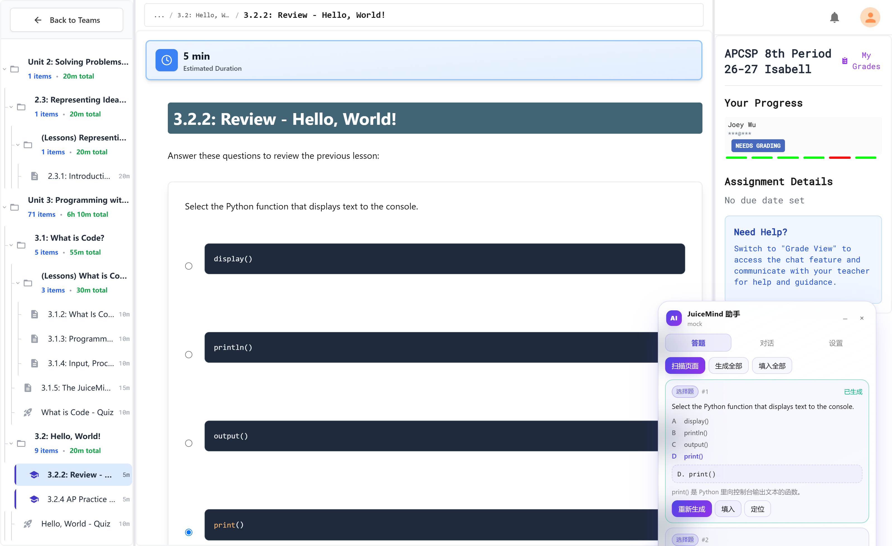
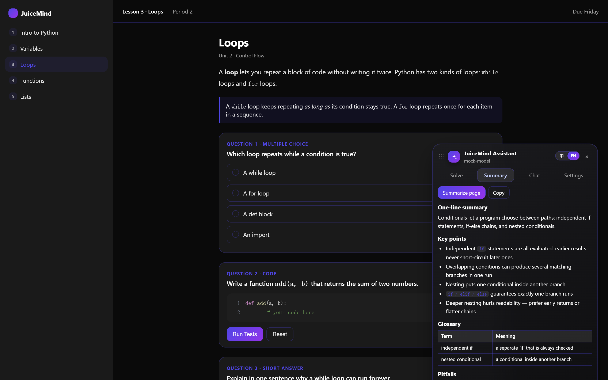
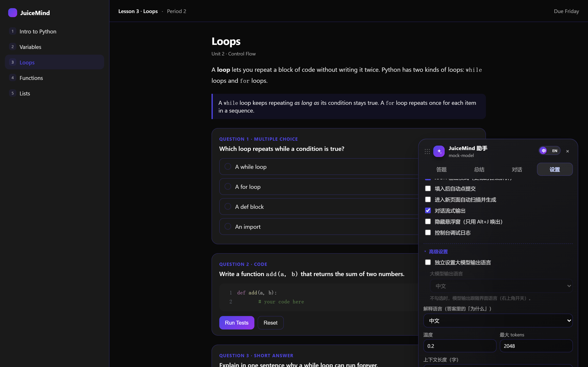

[English](README.en.md) | 中文

# JuiceMind AI 答题助手

给 [play.juicemind.com](https://play.juicemind.com) 用的 Tampermonkey 脚本：识别页面上的题目，调用大模型 API 生成答案，再全流程、全自动地填回页面并提交。

## 安装（约 1 分钟）

1. 浏览器装 [Tampermonkey](https://www.tampermonkey.net/)（Chrome / Edge / Firefox）。
2. 点以下链接安装脚本，Tampermonkey 弹出安装页后点「安装」：

   **https://raw.githubusercontent.com/tev6/JuiceMind-Auto/main/juicemind-ai-assistant.user.js**

3. 打开JuiceMind的任意课程页，右侧会出现面板。没看到就按 `Alt + J`。

## 配置（约 30 秒）

点面板里的「设置」：

| 填什么 | 例如 |
| --- | --- |
| API Base URL | `https://api.deepseek.com/v1`（也可先选「服务商预设」自动填） |
| API Key | `sk-...`（你自己的 key） |
| 模型 | 如 `deepseek-flash` |

点「保存」→「测试连接」，看到成功就能用了。

> 支持 OpenAI 兼容接口：OpenAI / DeepSeek / Moonshot / OpenRouter / 本地 Ollama。

## 使用

| 场景 | 使用方法 |
| --- | --- |
| 解多题 | `扫描页面` → `生成全部` → `填入全部` |
| 解单题 | 该题卡片上点 `生成` → `填入` |
| 纯教程页 | 切到「总结」一键生成速学笔记，或「对话」中问某个知识点 |

快捷键：`Alt + J`（Mac 为 `⌥ J`）收起/展开 · `Alt + Enter` 生成全部 · `Alt + Shift + S` 扫描。

**中英文一键切换**：标题栏右侧有个 `中 / EN` 拨动开关，点一下整个插件（界面文字 + 大模型输出语言）一起切换，不用逐项改设置。

**总结**：切到「总结」页点「总结本页」，边生成边显示（流式），会把这一页教程压成速学笔记——一句话总结、核心要点、关键词表、易错点、自测题，可直接复制。

扫描结果每张卡片右上角有 `▾`，点开看完整题干、全部选项和完整答案；卡片的「复制答案」和对话里代码块的「复制代码」都是一键复制。对话内容按 Markdown 渲染（标题 / 列表 / 表格 / 代码块）。

页脚会显示本会话累计的 token 用量；请求进行中可点页脚右侧的「停止」中断，已生成的内容会保留。

悬浮窗可以拖：拖标题栏或底部移动整窗，收起后变成圆钮，圆钮也能直接拖。

支持的题型：选择题 / 多选 / 简答 / 论述 / 填空，以及 CodeMirror 编程练习和内嵌 IDE。

**高级设置**：设置页底部折叠区，收着温度、最大 tokens、上下文长度、补充提示词、解释语言，以及「独立设置大模型输出语言」——默认不勾选，模型输出跟着右上角语言开关走；勾选后可以单独指定输出语言。

## 常见问题

**面板没出现** — 脚本没启用，或不在 `*.juicemind.com` 下。刷新后按 `Alt + J`。

**401 / 403** — Key 或者 Base URL 填错

**`HTTP 400 ... supported API model names are ...`** — 你填的模型名这个接口不认

**扫不到题** — 等页面加载完再扫

## 想改脚本

- `src/part1..6.js` 是源码分片，合并后就是 `juicemind-ai-assistant.user.js`
- 站点怎么选元素、怎么写进编辑器：见 [notes/site-analysis.md](notes/site-analysis.md)
- 改完 `src/` 后运行 `node scripts/build.mjs` 重新生成 bundle；CI 会校验两者是否一致
- 学生端会自动升级：脚本头带 `@updateURL`，Tampermonkey 每次检查到版本号变化就拉新版
- 本地测试：`npm i` → `npm test`（jsdom 87 项）、`npm run test:ui`（拖拽 / 隐藏 / 流式，需要本机 Chrome）
- 真实页验收与截图：把条目 ID 填进 `test/items.local.json`（模板 `test/items.example.json`，该文件不进仓库），再跑 `node test/real.js` / `node test/shots-real.js`

## 贡献

本脚本由作者基于 JuiceMind 中的 APCSP 课程进行测试，暂未验证 JuiceMind 其他课程的适配情况。因此，作者无法保证该脚本在其他课程中也能完整运行。

欢迎通过 PR 或 Issue 补充其他课程的适配、报告问题，或提出改进建议。

## 更新记录

- **1.7.0** — 标题栏改为「中 / EN」一键切换（界面文字 + 模型输出语言一起切）；移除与关闭等价的「–」按钮；设置页重构出「高级设置」折叠区（温度 / 最大 tokens / 上下文长度 / 补充提示词 / 解释语言 / 独立设置模型输出语言）；总结页改为流式输出。
- **1.6.0** — 新增「总结」页（一键把教程压成速学笔记，可复制）；Mac 键盘支持（⌥J，改用 e.code 识别，不再受 Option 组合字符影响）；收起后的圆钮可直接拖动；标题栏换成矢量图标。
- **1.5.0** — 学生端自动更新（`@updateURL`）；请求失败自动重试（429/5xx/超时，指数退避，最多 2 次，已开始输出则不重试）；页脚新增 token 用量与「停止」按钮；新增 `scripts/build.mjs` 与 CI 校验 bundle 与 src 一致。
- **1.4.0** — 对话流式输出（带光标、可中断阅读）；悬浮窗可拖动（拖头部或底部，位置记住）；设置里新增「隐藏悬浮窗」（勾选后默认不显示，只用 `Alt+J` 唤出）；新增英文 README。
- **1.3.0** — 对话支持 Markdown 渲染；对话代码块与答案卡片都能一键复制；扫描结果可逐题展开（含「展开全部」）；补充服务商各类模型
- **1.2.0** — 修复模型名称识别错误的问题
- **1.1.0** — 修复编程练习页扫不到题的错误
- **1.0.0** — 初版。

## 免责

仅供学习交流，请遵守所在学校的学术规范。
