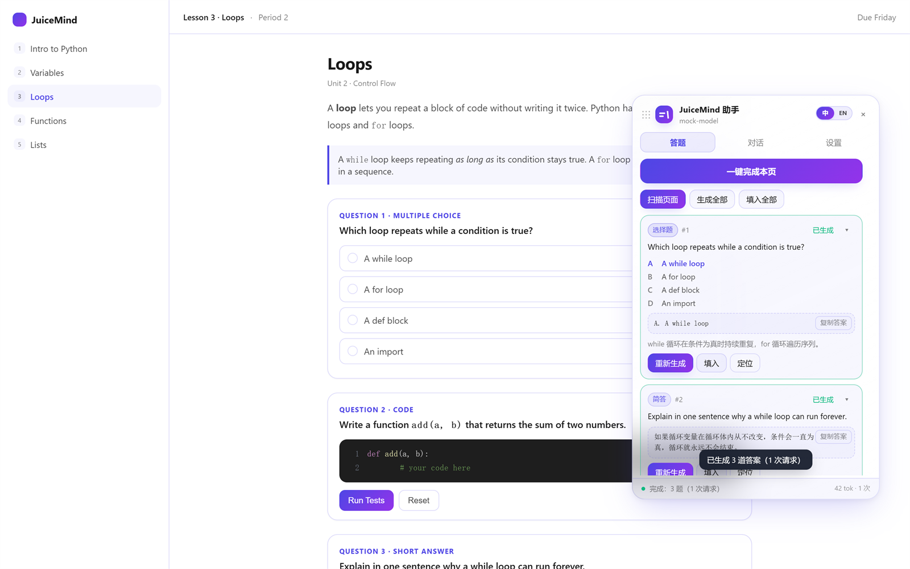
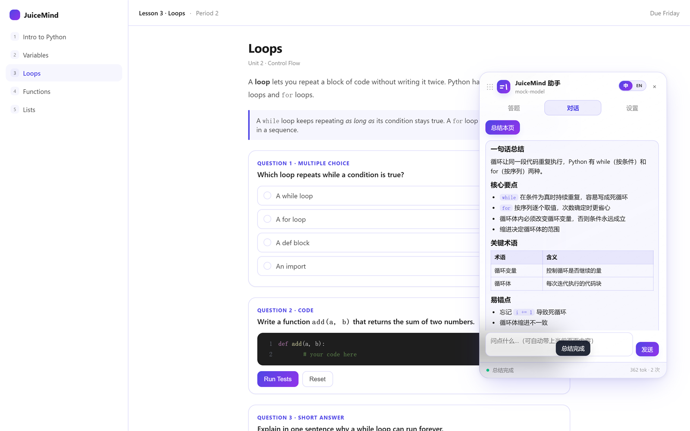
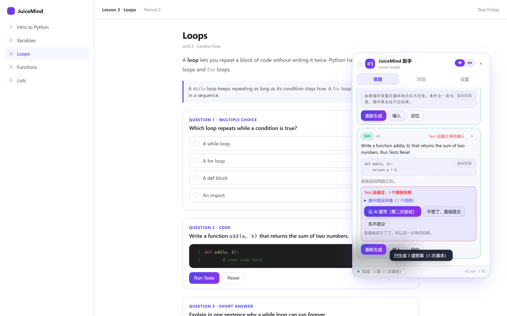

[中文](README.zh-CN.md) | English

  

# JuiceMind AI 答题助手

给 [play.juicemind.com](https://play.juicemind.com) 用的 Tampermonkey 脚本：识别页面上的题目，调用大模型 API 生成答案，再全流程、全自动地填回页面并提交。

## 目录

- [功能](#功能)
- [安装](#安装)
- [更新插件](#更新插件)
- [配置](#配置)
- [使用](#使用)
- [代码题的 Test 二次验证](#代码题的-test-二次验证)
- [常见问题](#常见问题)
- [开发](#开发)
- [贡献](#贡献)
- [更新记录](#更新记录)
- [许可与免责](#许可与免责)

## 功能

| 功能 | 说明 |
| --- | --- |
| **一键完成整页** | 检测 → 生成 → 填入 → 提交，逐题走同一套流程 |
| **代码题 Test 二次验证** | 提交编程题之前先替你点站点 IDE 里橙色的 **Tests** 按钮；有用例没过，就把期望输出和实际输出摆出来，**由你决定**要不要让 AI 重写 |
| **批量答题** | 一次请求答完整页，5 题页面实测输入 token 降 70% |
| **省 token** | 上下文按题截取、解析默认关闭、按题型收紧 max_tokens |
| **拟人写入** | 代码题逐字敲进编辑器，随机节奏与停顿，不是一次整篇替换 |
| **总结速学** | 教程页压成速学笔记：一句总结、核心要点、关键词表、易错点、自测题——笔记直接落在对话里，可以接着往下问 |
| **对话问答** | 带 Markdown 渲染、流式输出、一键复制代码块 |
| **中英一键切换** | 标题栏拨动开关，界面文字和模型输出语言一起切 |
| **题型覆盖** | 选择 / 多选 / 简答 / 论述 / 填空 + CodeMirror 编程题 + 内嵌 IDE |
| **悬浮窗** | 可拖动、可折叠成圆钮，页脚显示本会话 token 用量 |

## 安装

### 方式一：一键安装

1. 浏览器装 [Tampermonkey](https://www.tampermonkey.net/)（Chrome / Edge / Firefox）。
2. 点以下链接安装脚本，Tampermonkey 弹出安装页后点「安装」：

   **https://raw.githubusercontent.com/tev6/JuiceMind-Auto/main/juicemind-ai-assistant.user.js**

3. 打开JuiceMind的任意课程页，右侧会出现面板。没看到就按 `Alt + J`。

### 方式二：手动粘贴

一键安装不灵，或者你想先看看代码再装：

1. 在浏览器里打开脚本源码：

   **https://raw.githubusercontent.com/tev6/JuiceMind-Auto/main/juicemind-ai-assistant.user.js**

2. 全选复制——记得连开头那段 `// ==UserScript==` 一起复制。
3. Tampermonkey：点工具栏图标 →「新建脚本」。
4. 删掉模板，粘贴，保存（Ctrl+S / Cmd+S）。
5. 打开JuiceMind的任意课程页。

> 手动粘贴的脚本照样能自动更新——脚本头带 `@updateURL`，Tampermonkey 会自己拉新版。想手动拉新版，见「[更新插件](#更新插件)」。

> 脚本只在应用端域名 `play.juicemind.com` 与 `classes.juicemind.com` 运行；营销站 `juicemind.com` 只有介绍页，不会注入面板。

## 更新插件

脚本会自己更新，但 Tampermonkey 大约一天才查一次，而且查到之后还要你点确认才会替换，所以新版本很容易被漏掉。想手动更新：

1. 点浏览器工具栏上的 **Tampermonkey 图标**。
2. 在展开的列表里找到 **JuiceMind 答题助手**，点 **Edit**。
3. 脚本自己的页面会在新标签页打开，切到 **Settings** 标签。
4. 往下拉到 **Updates**，点 **Check for userscripts updates**。

Tampermonkey 会拿 GitHub 上的版本号和本地比一比，有新版本就问你一句要不要装——点「确定」，再刷新 JuiceMind 那个页面就是新版了。

> Tampermonkey 的脚本列表页上也有一个「检查更新」按钮，作用一样，只是会一次更新你所有脚本。

## 配置

点面板里的「设置」：

| 填什么 | 例如 |
| --- | --- |
| API Base URL | `https://api.deepseek.com/v1`（也可先选「服务商预设」自动填） |
| API Key | `sk-...`（你自己的 key） |
| 模型 | `deepseek-flash` |

点「保存」→「测试连接」，就能用了。

> 支持 OpenAI 兼容接口：OpenAI / DeepSeek / Moonshot / OpenRouter / xAI / Gemini / 本地 Ollama。

## 使用

| 场景 | 使用方法 |
| --- | --- |
| **一键完成整页** | 点「**一键完成本页**」——检测 → 生成 → 填入 → 提交，逐题走同一套流程 |
| 解多题 | `扫描页面` → `生成全部` → `填入全部`。三个按钮按进度依次出现，你只会看到当前能做的这一步；`扫描页面` 一直留着，想重扫随时点 |
| 解单题 | `扫描页面` → 该题卡片上点 `生成` → `填入` |
| 纯教程页 | 切到「对话」，点「总结本页」生成速学笔记，再在同一个输入框里接着问 |

每道题的结果都会回报给你，你始终知道站点到底收没收这份答案。

快捷键：`Alt + J`（Mac 为 `⌥ J`）收起/展开 · `Alt + Enter` 生成全部 · `Alt + Shift + S` 扫描。

## 代码题的 Test 二次验证

编程题是唯一一种**交上去就改不了**的答案。所以提交之前，插件会先替你点站点 IDE 里橙色的
**Tests** 按钮跑一遍单元测试，再看结果：

- **全部通过** → 照常提交。
- **有用例没过** → 把错题信息摆到卡片上：用例名、测试说明、**期望输出**、**实际输出**、测试备注。
  详情默认收起，点「展开错误详情」才看。

**不会背着你自动重试。** 卡片上给你三个选择：

| 选择 | 结果 |
| --- | --- |
| **让 AI 重写（第二次尝试）** | 把期望/实际的差异喂给模型重写程序——重写提示词里写明这是**第二次重试**，模型知道要在上一版基础上改，而不是从头再来。改完会再跑一遍测试 |
| **不管了，直接提交** | 就按现在的代码提交 |
| **先不提交** | 这题不交，插件继续做下一题 |

第二次改完还是不过测试，会**再问你一次**，不会有第三次自动重试。

想省掉跑测试的那几秒，去「设置」里把「**代码题用站点的 Test 二次验证**」关掉即可。

## 常见问题

**Tampermonkey 弹「跨域资源」授权窗** — 点 `Always allow domain` 放行这个 API 域名，或者点 `Always allow` 以后不再看到。脚本已经声明了跨域访问权限，只有装的是老版本脚本、或者 Tampermonkey 设成严格模式时才会弹。见「配置」。

**脚本没有自动更新** — Tampermonkey 大约一天才查一次 `@updateURL`，而且查到之后还要你点确认才会替换，所以新版本很容易被漏掉。想立刻拉最新版，照 [更新插件](#更新插件) 里的步骤走：工具栏图标 → 展开脚本 → **Edit** → **Settings** → **Updates** → **Check for userscripts updates**。Tampermonkey 的脚本列表页上也有一个「检查更新」按钮，会一次更新你所有脚本。

**面板没出现** — 脚本没启用，或不在 `play.juicemind.com` / `classes.juicemind.com` 下。刷新后按 `Alt + J`。

**401 / 403** — Key 或者 Base URL 填错

**`HTTP 400 ... supported API model names are ...`** — 你填的模型名这个接口不认

**扫不到题** — 等页面加载完再扫

**卡片上的标记是什么意思？**

| 标记 | 含义 |
| --- | --- |
| `已提交` | 提交成功，站点判定正确（或待老师批改） |
| `已提交·答错` | 提交成功，但站点判定答案不正确 |
| `提交失败` | 没提交上去（没找到按钮 / 按钮仍是禁用 / 接口报错），卡片上会写明原因 |

**提交后答案改不了了** — 站点就是这样。`已提交·答错` 表示提交成功但答案不对，能做的只有知道结果。你调用的AI也可能犯错，这正是脚本把每道题的结果都回报给你的原因。

**「一键完成本页」具体做了什么？** 每道题依次：填入答案、点提交、等结果、关弹窗。已经提交过的题不会再去动它——既不重填也不重交。生成阶段仍然是一次请求（只答还没交的那些题）；只有填入和提交是逐题做的。

**进阶设置在哪？** 设置页底部的折叠区——温度、两个 token 上限、上下文长度、补充提示词、解释语言，以及「独立设置大模型输出语言」（默认不勾选，模型输出跟着右上角语言开关走）。

**两个 token 上限是干什么的？** 「答案生成最大 tokens」管的是生成答案时的输出上限（默认 2048），「页面总结最大 tokens」管的是页面总结和对话回复（默认 4096）。分开算之后，一篇长总结就不会再把答案的额度吃掉。

**写完代码为什么要等几秒？** 代码敲进编辑器之后，页面还要同步、运行一遍才肯收下答案。提交太快，站点会弹一个提示框，反过来把后面的题全挡住。「代码写入后等待（秒）」调的就是这段停顿（3~10 秒，默认 5）。

**怎么展开收起的扫描、看 token 用量、挪面板？** 扫描收起后，点它上方可以展开看完整题干、全部选项和完整答案。页脚显示本会话累计的 token 用量，请求进行中可以点「停止」中断，已生成的内容会保留。拖标题栏或底部移动整窗，收起后变成可拖动的圆钮。

## 开发

- `src/part1..6.js` 为源码分片，合并后便是 `juicemind-ai-assistant.user.js`
- 站点怎么选元素、怎么写进编辑器：见 [notes/site-analysis.md](notes/site-analysis.md)
- 改完 `src/` 后运行 `node scripts/build.mjs` 重新生成 bundle；CI 会校验两者是否一致
- 发布循环：`node scripts/build.mjs --bump patch` 一次性改 `@version`、`VERSION`、`package.json` 并重建 bundle。CI 会在「bundle 变了但版本号没变」时拦下这次推送——Tampermonkey 只认版本号，没升号的发布学生端永远收不到
- 学生端会自动升级：脚本头带 `@updateURL`，Tampermonkey 每次检查到版本号变化就拉新版
- 本地测试：`npm i` → `npm test`（jsdom 218 项）、`npm run test:ui`（拖拽 / 隐藏 / 流式 / 一键全流程，需要本机 Chrome）
- 文档配图：`npm run shots` 用本地模拟页生成，不含任何个人信息
- 图标：设计稿在 `assets/icon/`——改 SVG 时保持坐标取偶数，再跑 `node assets/icon/render.cjs` 重新生成 PNG
- 真实页验收与截图：把条目 ID 填进 `test/items.local.json`（模板 `test/items.example.json`，该文件不进仓库），再跑 `node test/real.js` / `node test/shots-real.js`

## 贡献

本脚本由作者基于 JuiceMind 中的 APCSP 课程进行测试，暂未验证 JuiceMind 其他课程的适配情况。因此，作者无法保证该脚本在其他课程中也能完整运行。

欢迎通过 PR 或 Issue 补充其他课程的适配、报告问题，或提出改进建议。

## 更新记录

完整历史见 [CHANGELOG.md](CHANGELOG.md)。

- **1.14.3** — **代码题提交前先用站点自己的 Test 验一遍**：插件替你点 IDE 里橙色的 **Tests** 按钮，有用例没过就把期望输出、实际输出摆到卡片上，**由你**选「让 AI 重写（第二次尝试）」「不管了，直接提交」还是「先不提交」。不会背着你自动重试，重写提示词里也写明这是第二次尝试；另加设置「代码题用站点的 Test 二次验证」，想省时间可以关掉
- **1.14.2** — **修好代码题把整个程序冲掉的问题**：像 `for i in _____(7):` 这种补空位的练习，模型只回了空里的 `range`，编辑器就被覆盖成了这一个词。现在提示词明确要求输出整段程序，万一模型还是只回一截，插件会把它拼回原代码；另加设置「代码写入后等待（秒）」（3~10 秒），提交前先等页面把代码同步好，免得站点弹提示框
- **1.14.1** — **修好「一键完成本页」只做完第一题的问题**：后面那些题其实**根本还没交**，之前却被当成「已提交过·跳过」——判断「交过没有」时搜得太宽（把别的题的状态词也捡来了），又把「按钮禁用」当成了「已提交」（其实没填答案时按钮也是禁用的）。现在一道一道往下做，直到本页全部完成
- **1.14.0** — **面板理顺了**：「总结」和「对话」合成一个「对话」页，速学笔记就作为一条回复落在里面，底下带复制按钮，可以接着往下问；「扫描页面」「生成全部」「填入全部」改成按进度依次出现，不用一次看全；答案生成和页面总结也拆成了两个 token 上限
- **1.13.0** — **已经提交过的页面改成跳过，不再报错**：题目一旦交上去，站点的「Submit Answer」就会永久禁用（状态变成 *Needs grading* / *Graded*）。现在脚本认得这个状态，会明确提示，并且不去碰那个按钮
- **1.12.3** — **修好了两个把答题卡死的报错**：「提交按钮还是禁用状态」和「模型未返回可解析的 JSON」。提交前会一直等到页面真的收下这道答案（页面漏掉第一次点击就把选项再点一次）；输出预算也放宽到了带思考的模型够用的程度，被截断一半的答案会尽量补全而不是直接丢掉
- **1.12.2** — 新插件图标：两行正在被写下的文字 + 一支斜切光标，替换原来的四角星；Tampermonkey 面板里的脚本图标同步更新
- **1.12.1** — 补全 `@connect` 域名声明，Tampermonkey 不再对已知服务商弹跨域授权窗
- **1.12.0** — **新增一键完成本页功能**——全流程从检测->生成->填入->提交，循环遍历所有题目
- **1.11.1** — 简单维护，修小错误
- **1.11.0** — 新增批量答题功能：一次请求答完整页（不含自动提交）；提示词继续精简（500→240 token）。5 题页面实测输入 1966→587 token（−70%）。
- **1.10.0** — **省 token 处理**：上下文按题截取，解析默认关闭，按题型设置 max_tokens。实测选择题单次相比上版本减少至约 −90%、简答题约 −55%。

## 许可与免责

MIT License，见 [LICENSE](LICENSE)。

项目仅供学习交流，请遵守所在学校的学术规范。
